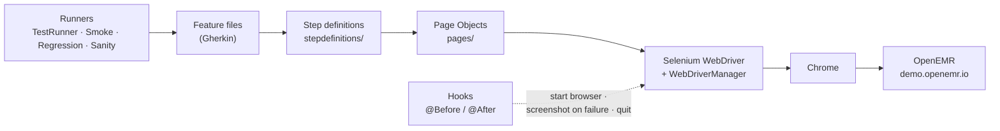

<div align="center">

# 🏥 OpenEMR Automation

### BDD UI test framework for the OpenEMR electronic medical record system

[](https://git.io/typing-svg)

<!-- ============ STATUS BAR ============ -->

-22c55e?style=for-the-badge)


</div>

---

## 📌 At a Glance

<table>
<tr>
<td width="50%" valign="top">

**🙋 What this is**

A UI automation framework that tests **[OpenEMR](https://www.open-emr.org/)**, the open-source electronic medical record and practice management system, through its public demo. Scenarios are written in plain-English **Gherkin**, backed by **Page Object** classes and run by **TestNG** through Maven, with a screenshot attached to the report whenever a scenario fails.

> *Healthcare software has no room for a silent failure: if a patient cannot be registered, the test must say so.*

</td>
<td width="50%" valign="top">

**📍 Quick facts**

| | |
|---|---|
| 🎯 **Application** | [demo.openemr.io](https://demo.openemr.io/openemr/interface/login/login.php) |
| 🧪 **Scenarios** | 5 (3 `@smoke` · 2 `@regression`) |
| ✅ **Latest run** | 5 / 5 passed · 2 m 22 s |
| 💻 **Run on** | macOS · OpenJDK 21 · Chrome |
| 📄 **Report** | [Cucumber HTML report (PDF)](OpenEMR%20Cucumber%20Test%20Report.pdf) |

</td>
</tr>
</table>

---

## ✅ Latest Results

| Feature | Scenario | Tag | Result |
|---|---|---|---|
| 🔐 OpenEMR Login | Successful login (admin user, English language) | `@smoke` |  |
| 🔐 OpenEMR Login (`openemr.feature`) | Successful login | `@smoke` |  |
| 👤 Patient Management | Add new patient successfully | `@smoke` |  |
| 👤 Patient Management | Add patient with missing mandatory fields → *"First Name is required"* | `@regression` |  |
| ⚙️ OpenEMR Admin Actions | Logout successfully | `@regression` |  |

<sub>Source: the Cucumber report in this repository (cucumber-jvm 7.15.0, OpenJDK 21.0.7, macOS). The demo site is shared and reset regularly, so results depend on its availability.</sub>

---

## 🛠️ Tech Stack

| Layer | Technology | Version | Purpose |
|---|---|---|---|
| Language | Java | 11 (runs on 11–21) | Test code |
| Browser automation | Selenium WebDriver | 4.18.1 | Drives Chrome |
| Driver management | WebDriverManager | 5.8.0 | Downloads the matching ChromeDriver automatically |
| BDD | Cucumber JVM (Gherkin) | 7.15.0 | Readable Given / When / Then scenarios |
| Test runner | TestNG + `cucumber-testng` | 7.9.0 | Runs features, tag-based suites |
| Build | Maven (Surefire 3.2.5) | — | Dependencies and test execution |
| Reporting | Cucumber HTML / JSON / JUnit XML | — | `target/` reports, failure screenshots |
| IDE | Eclipse / IntelliJ IDEA | — | Development |

---

## 🏗️ Framework Architecture



**Design patterns applied**

- **Page Object Model** — each screen (Login, Patient, Admin, Insurance) keeps its own locators and actions
- **BDD with Cucumber** — scenarios read as plain English for testers, developers and clinical stakeholders
- **Hooks** — a fresh Chrome per scenario; a PNG screenshot is attached to the report on failure
- **Tag-based runners** — one runner per suite (`@smoke`, `@regression`, `@sanity`) plus a combined runner
- **Explicit waits** — `WaitUtils` and `WebDriverWait` for menus and iframe-hosted forms

---

## 📁 Project Structure

```
OpenEMR_Automation/
├── src/test/java/
│   ├── base/
│   │   └── BaseClass.java            ← shared driver setup
│   ├── pages/                        ← Page Object Model
│   │   ├── LoginPage.java            ← username, password, language, login
│   │   ├── PatientPage.java          ← Patient › New/Search, demographics form
│   │   ├── AdminPage.java            ← Admin menu, logout
│   │   └── InsurancePage.java        ← insurance entry inside the patient frame
│   ├── stepdefinitions/
│   │   ├── Hooks.java                ← @Before / @After, failure screenshots
│   │   ├── LoginSteps.java
│   │   ├── PatientSteps.java
│   │   ├── AdminSteps.java
│   │   └── OpenEMRSteps.java
│   ├── runners/
│   │   ├── TestRunner.java           ← @smoke or @regression (default)
│   │   ├── SmokeRunner.java
│   │   ├── RegressionRunner.java
│   │   └── SanityRunner.java
│   └── utils/
│       ├── DriverFactory.java
│       ├── DriverManager.java
│       └── WaitUtils.java
├── src/test/resources/features/
│   ├── login.feature
│   ├── openemr.feature
│   ├── patient.feature
│   └── admin.feature
├── OpenEMR Cucumber Test Report.pdf  ← latest run, exported from the HTML report
├── pom.xml
└── testng.xml
```

---

## 🎯 Test Coverage

<details open>
<summary><strong>🔐 Authentication</strong></summary>

<br>

- Open the OpenEMR login page, enter credentials, pick the interface language
- Confirm the dashboard loads after a successful login
- Log out from the **Admin** menu

</details>

<details>
<summary><strong>👤 Patient Management</strong></summary>

<br>

- Navigate **Patient › New/Search** and fill the demographics form (first name, last name, date of birth, sex)
- Save the record and confirm the patient is created
- Negative test: leave **First Name** empty and verify the *"First Name is required"* validation message

</details>

<details>
<summary><strong>🧾 Insurance (page object ready)</strong></summary>

<br>

- `InsurancePage` adds a provider and policy number inside the patient frame (`pat`); a feature file for it is on the roadmap

</details>

---

## ⚙️ Getting Started

**Prerequisites:** JDK 11 or newer · Maven 3.8+ · Google Chrome · Git
No manual ChromeDriver download is needed — WebDriverManager fetches the right version.

```bash
git clone https://github.com/rbchy/OpenEMR_Automation.git
cd OpenEMR_Automation
mvn clean install -DskipTests
```

---

## ▶️ Running the Tests

```bash
# Default suite: @smoke or @regression (TestRunner)
mvn clean test

# One suite by runner
mvn clean test -Dtest=SmokeRunner
mvn clean test -Dtest=RegressionRunner

# Any tag expression
mvn clean test -Dcucumber.filter.tags="@smoke"
```

**From the IDE:** right-click `runners/TestRunner.java` (or `testng.xml`) → **Run As › TestNG Test**.

**Reports** are written to `target/` after every run:

| File | Format |
|---|---|
| `target/cucumber-report.html` | Cucumber HTML report (with failure screenshots) |
| `target/cucumber.json` | JSON, for Allure / Jenkins plugins |
| `target/cucumber.xml` | JUnit XML, for CI test summaries |
| `target/smoke-report.html`, `regression-report.html`, `sanity-report.html` | Per-suite HTML reports |

---

## 🏷️ Tags

| Tag | Meaning | Scenarios |
|---|---|---|
| `@smoke` | Critical path — build verification | 3 |
| `@regression` | Negative and end-to-end flows | 2 |
| `@sanity` | Reserved for quick post-deploy checks | 0 |

---

## ⚠️ Healthcare Data Notice

> This framework runs only against the **public OpenEMR demo**, using the demo's published credentials. All test data (for example *John Doe, 1980-01-01*) is synthetic.

- Never use real patient information in a test scenario
- Treat even test environments with HIPAA-minded care: no real PHI in data, logs or screenshots
- The demo is shared and reset regularly; do not rely on records persisting between runs

---

## 📈 Roadmap

- [ ] Allure reports with step screenshots
- [ ] GitHub Actions workflow running headless Chrome on every push
- [ ] Parallel execution (`@DataProvider(parallel = true)`) with a thread-safe driver
- [ ] Cross-browser: Firefox and Edge
- [ ] Insurance, appointment scheduling and encounter scenarios
- [ ] Data-driven patients from JSON / Excel
- [ ] REST Assured checks against the OpenEMR REST / FHIR API
- [ ] Credentials moved to a config file / environment variables

---

## 🔗 Related Projects

| Project | Stack |
|---|---|
| ⭐ [RbcTcsWorld E-Commerce Suite](https://github.com/rbchy/RbcTcsWorld_ECommerceSuite) | Spring Boot · REST Assured · Selenium · Playwright · Appium · CI quality gates |
| 🧪 [ClinTrial-Connect](https://github.com/rbchy/RbcTcsWorld_ClinTrial-Connect) | Spring Boot · Java (clinical trials) |
| 🏭 [PPES Pharma Packaging](https://github.com/rbchy/PPES-Pharmaceutical-Packaging-Management) | Java 17 · MySQL 8 |
| ☁️ [Sauce Labs Cloud Automation](https://github.com/rbchy/QaBrainsSauceLabAPI_Automation) | Selenium · Cucumber · Sauce Labs |

<sub>All projects: [github.com/rbchy](https://github.com/rbchy)</sub>

---

## 👤 Author

<div align="center">

**Ranajit Baran Chowdhury (RB Chowdhury)**
QA Automation Engineer / SDET · West Norriton, Pennsylvania, USA

[](https://www.linkedin.com/in/rbchy/)
[](https://github.com/rbchy)
[](https://rbchy.github.io/rbchy/)
[](https://rbc6543.wixsite.com/rbc-portfolio)
[](mailto:chyranajit@gmail.com)

<sub>Provided for educational and professional QA automation purposes. OpenEMR is © its contributors and licensed under GPL; this repository only tests its public demo.</sub>

⭐ *If this framework helps you, a star on the repo is appreciated.*

</div>
